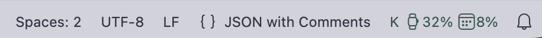
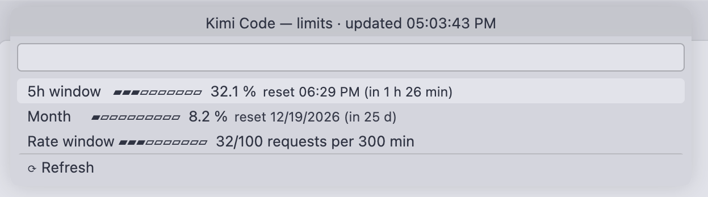

# Kimi Limits

A VS Code extension that shows Kimi Code's 5-hour usage window and monthly quota in the status bar.

## Screenshots

Status bar indicator:

Details panel (click the status bar item):

## Features

- A compact `K $(watch)15% $(calendar)7%` indicator with color-coded thresholds.
- A details panel with progress bars, reset times, the rate window, and manual refresh.
- Automatic API polling every 60 seconds.
- Separate states for a missing key, authentication errors, network failures, and invalid responses.
- Empty or incomplete responses do not overwrite the last valid data. Responses without a rate window are handled normally.
- Automatic interface localization: Russian when the VS Code interface language is Russian, English for all other languages.

## Installation

1. Run `npm install`, `npm run compile`, and `npx vsce package`.
2. In VS Code, open **Extensions: Install from VSIX…** and select the generated `.vsix` file.

## API Key

The key is loaded in the following order:

1. VS Code SecretStorage, using the **Kimi Limits: Set API Key** command.
2. The `env.ANTHROPIC_API_KEY` field in `~/.claude/settings.json`.

The key is never written to logs or displayed in the interface.

## Localization

The extension selects its language automatically: Russian is used when `vscode.env.language` starts with `ru`; English is used otherwise. VS Code applies the same rule to the command title, extension description, and configuration descriptions through the included NLS files.

## Settings

All settings are grouped under `kimiLimits`: polling interval, API host, Claude settings path, status bar alignment, progress bar length, color thresholds, and rate-window visibility in the tooltip.
